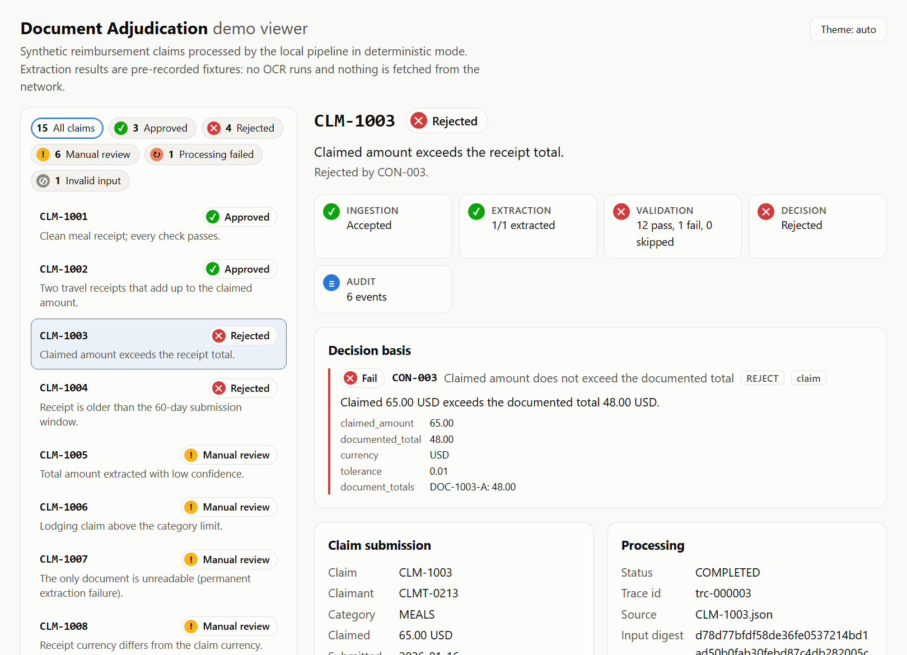
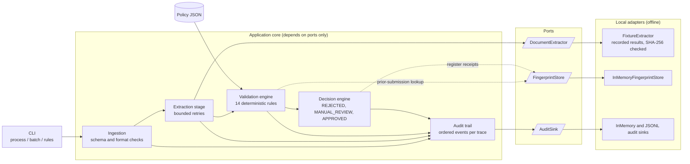

# Document Adjudication Pipeline

**Turn documents into explained, auditable decisions.** A compact, fully offline reference implementation of a
document-processing decision pipeline:

**synthetic document → extraction (replayed fixture) → deterministic validation → decision → audit trace**

It adjudicates fictional expense-reimbursement claims, explains every outcome with the exact evidence and
thresholds behind it, and records each processing step. **No OCR runs:** extraction results are pre-recorded
fixtures replayed behind the extractor interface, where a real OCR service would plug in. Pure Python standard
library, no credentials, no network.



**Stack:** Python 3.11+ standard library only · ports and adapters · `unittest` · static HTML viewer · GitHub
Actions (Ubuntu and Windows, Python 3.11 to 3.13). **Try it:** [Quick start](#quick-start) or open
`demo/index.html` offline.

> **Independent demonstration.** Original code based on general, publicly known software patterns. It contains no
> code, data, business rules, configuration or identifiers from any employer or client system. Every merchant,
> identifier, amount and document is synthetic. No OCR, machine-learning model or cloud service runs here. It has
> never been deployed and makes no production claims.

## The problem

Automating document-based decisions (expense claims, benefit requests, invoices) is mostly not an OCR problem.
The hard parts are:

- **Uncertain inputs**: extraction is probabilistic; fields go missing, confidence is low, numbers are misread.
- **Explainability**: reviewers and auditors must see *why* a decision was made and be able to re-check it.
- **Safe failure**: missing evidence must not pass as approval, and an outage must not become a rejection.
- **Traceability**: each decision must be reproducible from its inputs and the exact policy in force.

## Features

- **14 deterministic, policy-driven rules**: document quality, formats, arithmetic consistency, category limits,
  submission window and duplicate receipts ([rule catalogue](docs/rules.md)).
- **Explained decisions**: `APPROVED`, `REJECTED` or `MANUAL_REVIEW`, each citing the rules and evidence behind it.
- **Fail-safe semantics**: a rule whose evidence is unavailable (`SKIPPED`) never rejects or approves; it sends the
  claim to a human. Only a rule that fully evaluated and failed with REJECT severity can reject, for example
  `DOC-001` when no document is attached at all. Approval needs at least one `PASS` and no `FAIL` or `SKIPPED`. A
  crashing rule cannot pass.
- **Status kept apart from the decision**: outages end as `FAILED` (retryable, no decision); unparseable input as
  `INVALID_INPUT`.
- **Bounded retries** for transient extraction failures; permanent failures are not retried.
- **Audit trail**: ordered events per trace id, in memory or as JSON Lines; decisions record the policy version and digest.
- **Duplicate receipts** detected within a claim (reject) and across claims (review), with idempotent reprocessing.
- **Reproducible**: a deterministic mode, golden tests for every sample, and generated synthetic data guarded
  against drift.
- **Static visual demo**: an HTML viewer of every case, its evidence and its audit trail.

## Architecture



A ports-and-adapters design: the core depends only on interfaces, and `bootstrap.py` is the single place that
wires concrete adapters. An OCR service, a durable store or a queue trigger would be a new adapter, not a change
to the rules or the pipeline. Details: [architecture](docs/architecture.md) and [design decisions](docs/design-decisions.md).

## Tech stack

| Area | Choice |
|---|---|
| Language | Python 3.11+ (`dataclasses`, `StrEnum`, `Protocol`, `Decimal`) |
| Runtime dependencies | None (standard library only) |
| Tests | `unittest`, also runs under `pytest` |
| Visual demo | HTML, CSS and vanilla JavaScript, no frameworks, no build step |
| Packaging and CI | `pyproject.toml` with an `adjudication` console script; GitHub Actions workflow |

## Quick start

Requirements: Python 3.11 or newer. Run from the repository root.

```bash
git clone <repository-url>
cd document-adjudication-pipeline

python -m adjudication rules                                          # the 14 rules
python -m adjudication process samples/claims/CLM-1003.json --verbose # one claim, every rule result
python -m adjudication batch samples/claims                           # all 15 samples -> demo-output/
```

On Windows use `py -3.11` if several interpreters are installed. `python -m pip install .` adds an
`adjudication` command.

### Visual demo

Open **`demo/index.html`** in a browser; no server is needed and nothing is fetched from the network. Pick a
claim to see its pipeline stages, decision basis and evidence, the synthetic receipt beside its recorded
extraction (with confidence against the policy threshold), every rule result and the audit timeline.
`demo/data.js` is generated: rebuild it with `python scripts/build_demo_data.py`. See the
[walkthrough](docs/walkthrough.md) for every command and output.

## Example: input and output

A claim (`samples/claims/CLM-1003.json`) references one synthetic receipt:

```json
{
  "claim_id": "CLM-1003",
  "claimant_id": "CLMT-0213",
  "category": "MEALS",
  "claimed_amount": "65.00",
  "currency": "USD",
  "submitted_on": "2026-01-16",
  "description": "Working dinner",
  "documents": [{ "document_id": "DOC-1003-A", "file": "DOC-1003-A.txt", "media_type": "text/plain" }]
}
```

```text
========================================
          SAFFRON LANE KITCHEN
          (fictional merchant)
========================================
Receipt   R-0114-0410
Date      2026-01-14
----------------------------------------
Set menu                           18.00
Set menu, large                    22.00
----------------------------------------
Tax                                 8.00
TOTAL USD                          48.00
========================================
SYNTHETIC DEMO DOCUMENT - NOT A REAL RECEIPT
```

The pipeline extracts the receipt (from its recorded result), runs the rules and rejects the claim:

```text
$ python -m adjudication process samples/claims/CLM-1003.json --deterministic
Claim     : CLM-1003  [source: CLM-1003.json]
Trace     : trc-000001
Status    : COMPLETED
Decision  : REJECTED - Rejected by CON-003.
Reasons   :
  - CON-003 [FAIL/REJECT] Claimed 65.00 USD exceeds the documented total 48.00 USD.
Checks    : PASS 12, FAIL 1, SKIPPED 0, NOT_APPLICABLE 1
Policy    : demo-2026.1
Audit     : 6 events
   1. INGESTION:RECEIVED
   2. INGESTION:ACCEPTED
   3. EXTRACTION:SUCCEEDED (document_id=DOC-1003-A, attempt=1)
   4. VALIDATION:COMPLETED
   5. DECISION:DECIDED (outcome=REJECTED)
   6. PIPELINE:COMPLETED (status=COMPLETED)
```

With `--json`, the same reason carries machine-checkable evidence: `claimed_amount 65.00`,
`documented_total 48.00`, `currency USD`, `tolerance 0.01`.

## Testing

```bash
python -m unittest discover -s tests -v    # or: python -m pytest
```

135 tests covering every rule path, decision precedence, ingestion, the extractor's integrity checks, retries and
failure semantics, the CLI, golden outcomes for all 15 samples, and drift between generated data and its
generator. GitHub Actions runs the suite and the demo batch in six jobs (Ubuntu and Windows, Python 3.11 to 3.13);
results are in the repository's Actions tab. It was also run locally on Windows with Python 3.11.9. More in
[testing](docs/testing.md).

## Project status

| | Capability |
|---|---|
| **Implemented** | Claim ingestion and validation, 14 rules, decision engine, bounded retries, audit trail (memory and JSONL), duplicate detection, deterministic mode, CLI, packaging, static visual demo, 135 automated tests |
| **Simulated** | OCR / document analysis: the `FixtureExtractor` replays **pre-recorded** extraction results; no OCR runs anywhere. Extraction-service failures are replayed from the same recordings |
| **Planned** | Azure AI Document Intelligence adapter, Azure Functions and Storage Queue triggers, Cosmos DB persistence, Azure OpenAI review assistant, transactional outbox, durable idempotency and concurrency control, dashboard over persisted results, sealed-dataset evaluation |
| **Verified in CI** | GitHub Actions: tests and demo batch on Ubuntu and Windows with Python 3.11 to 3.13 (6 jobs) |

## Limitations and roadmap

- No real OCR, LLM or cloud service is called; extraction is simulated from recorded fixtures.
- State is in memory per process, so cross-claim duplicate detection depends on processing order within a run.
- Retries are immediate and in-process; there is no queue, backoff or dead-letter path.
- Receipts in another currency go to review (no conversion); rules model a fictional domain.

Next steps, all optional and off by default so the offline demo keeps working: durable SQLite state, reliability
patterns (outbox, concurrency control, backoff), Azure adapters behind the existing ports, an advisory LLM for
manual-review cases, and sealed evaluation datasets. Full list: [limitations and roadmap](docs/roadmap.md).

## Documentation

| Document | Contents |
|---|---|
| [docs/architecture.md](docs/architecture.md) | Layers, ports and adapters, processing flow, audit events, repository layout |
| [docs/design-decisions.md](docs/design-decisions.md) | The main technical choices and their trade-offs |
| [docs/rules.md](docs/rules.md) | Rule catalogue, outcome semantics, demo policy |
| [docs/walkthrough.md](docs/walkthrough.md) | CLI reference, demo commands with real output, visual demo usage |
| [docs/testing.md](docs/testing.md) | Test suite, golden and drift tests, verification limits |
| [docs/roadmap.md](docs/roadmap.md) | Limitations and planned work |
| [samples/README.md](samples/README.md) | The 15 synthetic scenarios |

## AI-assisted development

I designed and directed this project; it was implemented with substantial help from Claude Code (Anthropic). I
defined the problem, scope, constraints and acceptance criteria, reviewed the design and the results, and decided
what to publish. Most of the code, tests and documentation were generated with the assistant under that direction,
which is why the commits carry a `Co-Authored-By` trailer. Results quoted here come from the automated tests,
evaluations and CI runs in this repository, on synthetic data. They show that the code behaves as described under
those conditions, not that it is ready for production, and nothing this README marks as simulated, planned or not
tested has been validated.

---

**License:** not yet selected.
