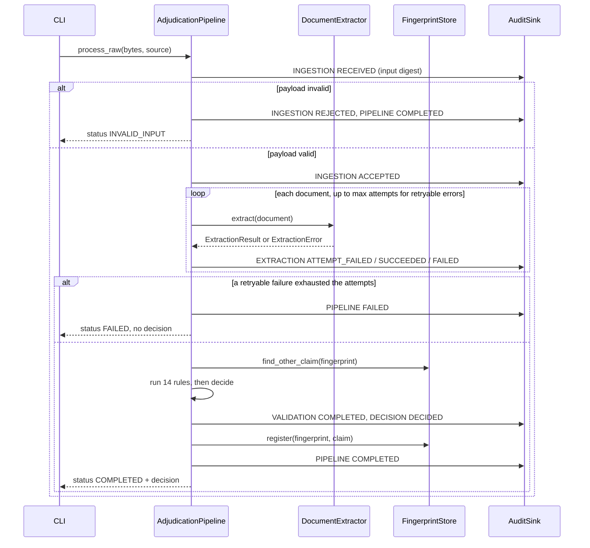

# Architecture

This document describes the components that exist in the current release. Planned components are listed
only in [roadmap.md](roadmap.md).

## Layers

| Layer | Package | Responsibility | Depends on |
|---|---|---|---|
| Domain | `adjudication/domain` | Immutable value objects (`Claim`, `ExtractionResult`, `RuleResult`, `Decision`, `AuditEvent`, `ProcessingResult`) and the `Policy` | Standard library only |
| Ports | `adjudication/ports.py` | `Protocol` interfaces the core needs: `DocumentExtractor`, `AuditSink`, `FingerprintStore`, `Clock`, `TraceIdFactory` | Domain |
| Core | `adjudication/core` | Ingestion, validation rules, validation engine, decision engine, audit trail, pipeline orchestration | Domain, ports |
| Adapters | `adjudication/adapters` | Local implementations of the ports | Domain, ports |
| Composition root | `adjudication/bootstrap.py` | Wires concrete adapters into the pipeline | Everything above |
| Interface | `adjudication/cli.py`, `reporting.py` | Command-line interface and plain-text rendering | Composition root |

The core never imports an adapter. Replacing the extractor or the audit store means writing a new adapter
and changing `bootstrap.py`; rules, decisions and orchestration stay untouched.

## Ports and their current adapters

| Port | Purpose | Adapter in this release |
|---|---|---|
| `DocumentExtractor` | Return structured fields for one document, or raise `ExtractionError(kind, retryable)` | `FixtureExtractor`: replays pre-recorded extraction results; **no OCR** |
| `AuditSink` | Receive every audit event as it is recorded | `InMemoryAuditSink`, `JsonlAuditSink` |
| `FingerprintStore` | Remember which claim first submitted each receipt fingerprint | `InMemoryFingerprintStore` (lives for one pipeline instance) |
| `Clock` | Timezone-aware UTC timestamps | `SystemClock`, `FixedClock` |
| `TraceIdFactory` | One trace id per submission | `RandomTraceIds` (UUID4), `SequentialTraceIds` |

## Processing flow



## Status and decision

Processing status and business decision are separate fields of `ProcessingResult`.

| Situation | Status | Decision |
|---|---|---|
| Every applicable rule passes | `COMPLETED` | `APPROVED` |
| A fully evaluated `REJECT`-severity rule fails | `COMPLETED` | `REJECTED` |
| A `REVIEW` rule fails, or any rule lacks evidence (`SKIPPED`) | `COMPLETED` | `MANUAL_REVIEW` |
| A document is permanently unreadable | `COMPLETED` | `MANUAL_REVIEW` |
| The extraction dependency stays unavailable after the retry budget | `FAILED` | none, the claim can be resubmitted |
| The submission cannot be parsed | `INVALID_INPUT` | none |

Decision precedence is `REJECTED > MANUAL_REVIEW > APPROVED`; the guarantees behind it are explained in
[design-decisions.md](design-decisions.md#3-fail-safe-decision-semantics).

## Audit events

Every event carries `trace_id`, `sequence`, `timestamp`, `stage`, `event`, `claim_id` (once known) and a
`detail` object.

| Stage | Event | Detail keys |
|---|---|---|
| `INGESTION` | `RECEIVED` | `source`, `input_digest` |
| `INGESTION` | `ACCEPTED` | `category`, `claimed_amount`, `currency`, `document_count` |
| `INGESTION` | `REJECTED` | `errors` |
| `EXTRACTION` | `ATTEMPT_FAILED` | `document_id`, `attempt`, `kind`, `retryable`, `message` |
| `EXTRACTION` | `SUCCEEDED` | `document_id`, `attempt`, `provider`, `source_sha256`, `fields`, `line_items` |
| `EXTRACTION` | `FAILED` | `document_id`, `attempt`, `kind`, `retryable`, `message` |
| `VALIDATION` | `RULE_ERROR` | `rule_id`, `error` (a rule raised; its result became `SKIPPED`) |
| `VALIDATION` | `COMPLETED` | `rules`, `results`, `outcomes` |
| `DECISION` | `DECIDED` | `outcome`, `reason_rules`, `policy_version`, `policy_digest` |
| `PIPELINE` | `COMPLETED` | `status` |
| `PIPELINE` | `FAILED` | `status`, `retryable`, `documents` |

## Data and configuration

- **Claim submission** (`samples/claims/*.json`): claim fields plus a list of document references. Document
  references are bare file names resolved against `--documents-dir`.
- **Synthetic documents** (`samples/documents/*.txt`): plain-text renderings of fictional receipts.
- **Recorded extractions** (`samples/extractions/*.json`): one per document, shaped like the output of a
  document-analysis service (fields with confidence, line items, page count). Each stores the SHA-256 of
  the document it describes and may declare a `simulated_failure` to replay.
- **Policy** (`adjudication/data/default_policy.json`): confidence threshold, amount tolerance,
  submission window, allowed currencies, required fields and per-category limits. Override with `--policy`.
- **Results**: `ProcessingResult` serialized to JSON; amounts are decimal strings.

## Repository layout

```
adjudication/
  domain/          models.py, policy.py
  core/            ingestion, parsing, fingerprint, audit, validation, decision, pipeline
    rules/         base contract + document, consistency and policy rules
  adapters/        extraction (FixtureExtractor), audit_sinks, stores, clock
  ports.py         interfaces the core depends on
  bootstrap.py     composition root
  cli.py           command-line interface
  reporting.py     plain-text rendering
  serialization.py JSON conversion for domain objects
  data/            bundled demo policy
demo/              static viewer (index.html, app.js, styles.css) and its generated data.js
samples/           generated synthetic claims, documents, recorded extractions, expected outcomes
scripts/           generate_samples.py, build_demo_data.py
tests/             unit, integration, CLI, golden and demo tests
docs/              this documentation
```
